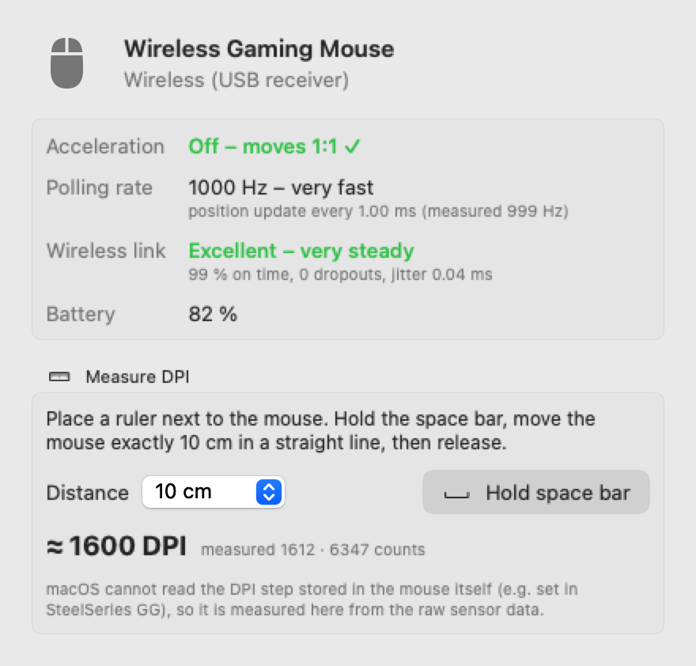

# ExactMouse Redux

**A free alternative to the SteelSeries ExactMouse Tool for macOS, inspired by the original. Turn off mouse acceleration on your Mac for precise, linear 1:1 mouse movement.**

Many gamers used the **SteelSeries ExactMouse Tool** to disable the Mac's mouse acceleration curve. That tool dates from 2010 and **stopped working properly on macOS 27**: it only runs through Rosetta, its settings no longer reliably reach the mouse, and *Start on Log On* has been broken since macOS 13.

That is what inspired **ExactMouse Redux**: an independent rebuild from scratch for current macOS (*Redux* means "brought back"). You get the same three modes and the same menu bar workflow, plus live mouse diagnostics. It runs natively on **Apple Silicon (M1–M5) and Intel**, from macOS 14.4 Sonoma up to **macOS 27**. It works with any mouse: SteelSeries, Logitech, Razer, Zowie and others.

<p align="center">
  <a href="https://github.com/iamadesignerusually/ExactMouse-Redux/releases/latest/download/ExactMouseRedux.dmg"></a>
  &nbsp;
  <a href="#option-1--one-command-recommended"></a>
</p>
<p align="center">
  <a href="https://github.com/iamadesignerusually/ExactMouse-Redux/releases/latest"></a>
  <a href="https://github.com/iamadesignerusually/ExactMouse-Redux/releases"></a>
  
  
  <br><sub>Free · Apple Silicon &amp; Intel · macOS 14.4 – 27 · <a href="https://github.com/iamadesignerusually/ExactMouse-Redux/releases">all versions</a> · <a href="CHANGELOG.md">changelog</a></sub>
</p>

[Deutsch](README.de.md) · [Legal notice](LEGAL.md) · [License](LICENSE)

> [!IMPORTANT]
> **Unofficial community project, not a SteelSeries product.** It is not affiliated with, endorsed, sponsored or supported by SteelSeries ApS.
> It was inspired by the SteelSeries ExactMouse Tool, and the idea for the original comes from SteelSeries. SteelSeries and ExactMouse are trademarks or registered trademarks of SteelSeries ApS. They are used here only to name that inspiration and to describe compatibility.
> The app contains no code, binaries or artwork from SteelSeries. See [LEGAL.md](LEGAL.md).

<p align="center">
  <picture>
    <source media="(prefers-color-scheme: dark)" srcset="docs/details-dark.png">
    
  </picture>
  <br><sub>Mouse details window (example data)</sub>
</p>

## Features

- **Three modes, same as the original**

  | Menu | Icon | What it does |
  |---|---|---|
  | **ExactMouse: Always On** | 🟢 | Acceleration off, re-applied every 5 s and right after a mouse connects or the Mac wakes. Wins against games, apps and System Settings. |
  | **ExactMouse: On** | 🟡 | Acceleration off. If System Settings or an app changes the mouse settings, it accepts the change, remembers it and switches to *Off*. |
  | **ExactMouse: Off** | 🔴 | Normal macOS acceleration, with the value that was active before. |

- **Main input device at the top of the menu**, with a real battery gauge and estimated remaining time (or a USB icon for wired mice), vendor, type, connection, polling rate and acceleration state at a glance.
- **Polished menu**: a click on a device slides to its page right in the menu (with a back button). The main device is a card (connection, Bluetooth signal, state, battery), the three modes as tiles and every further device on one line. Each row has the same width and a quiet hover. Main device, mode and devices at a glance, everything else in the **settings window** (⌘,): six tabs (General, Mouse, Devices, Apps, Statistics, Pro), each with a small side menu (e.g. Mouse → Movement · Trackpads · Scrolling), plus a **searchable Help**.
- **Buttons & macros (Pro):** map every extra mouse button (back/forward, Mission Control, Spaces, shortcuts, apps, media keys) and the **12 side keys of MMO mice like the Razer Naga** (beta), per app if you like. Macros can be recorded or built step by step, then played once, repeated while held, or toggled.
- **Statistics:** how far your mouse travels (today, month, year, all time), clicks per button, your most used macros, and a weekday × hour heat map of when you move, click and scroll. Everything stays local, with no keystrokes recorded.
- **Gaming:** automatic game mode, low battery warnings, a sensitivity calculator (cm/360°, eDPI, conversion between games), and setting the DPI of Logitech mice.
- **Automation:** `exactmouse-redux://` URLs for Shortcuts, Focus, Raycast and Stream Deck.
- **Pro features** (free during Early Access): **stepless linear fine tuning** (0.10–4.00× in 0.01 steps, with fine slider, number field and arrows), settings per device, **profiles per app** (e.g. 1:1 only in your game), scroll acceleration off, mouse-only reverse scrolling, plus the diagnostics, automatic game mode and battery warnings. The **Pro tab** shows them all at a glance.
- **Speed without acceleration:** a slider from 0.3× to 2.6×, always linear and never a curve. The middle position is raw 1:1.
- **Signed updates:** a daily check against GitHub Releases and one-click install. Every update is signed with the developer's private key (Ed25519), and the app installs only updates whose signature matches. Checksum and code signature are checked as well.
- **Short setup on first launch:** "What do you use your mouse for?" (Gaming, Design & photo, Office) sets a fitting starting point. Permissions are explained and asked only when a feature needs them.
- **Several mice, controllers and remotes:** every mouse is switched, and you can pick the main device shown on top of the menu. Game controllers, presenters/remotes and pen tablets are recognised and left unchanged unless you include them. Virtual devices (e.g. Karabiner) are switched too.
- **Bluetooth signal in the menu** (excellent / good / fair / weak) for every Bluetooth mouse, with the exact dBm in the details window.
- **Report a problem:** a diagnostic report with no names or serial numbers and a preview of exactly what is copied, plus a check of the macOS system interfaces the app needs.
- **Menu with explanations.** Every mode tells you what it does, and the menu shows a live status line saying whether macOS currently applies acceleration.
- **Battery in the menu bar.** A small upright battery appears to the left of the mouse icon when a wireless mouse reports its level, and turns red at 15 %. The exact percentage is in the tooltip.
- **Connected mice** with vendor, connection type (USB cable, USB wireless receiver, Bluetooth), battery and polling rate.
- **Trackpads too.** The built-in trackpad and the Magic Trackpad also move 1:1 in all three modes. This is on by default and can be switched off under **Settings → Mouse → Include trackpads**. The details window shows trackpad information: whether acceleration is off, tracking speed, tap to click, Force Click, three-finger drag and battery.
- **Mouse Details & Measurement**
  - **Polling rate**, measured live from the raw HID reports (125 … 8000 Hz).
  - **Transmission / wireless link quality**: how evenly the reports arrive, with on-time share, dropouts and jitter.
  - **Bluetooth signal** as bars plus a plain word (*Excellent / Good / Fair / Weak*), with the dBm value in brackets.
  - **Configured DPI read from Logitech mice** (HID++ over Bluetooth or USB, read-only).
  - **DPI measurement** for all other mice. macOS cannot read the DPI step stored inside the mouse. Hold the space bar, move the mouse a known distance along a ruler, and Redux works out the DPI from the raw sensor counts.
- **Four menu bar icon styles**, modelled on polished Mac utilities: *Colour* (default), *Monochrome*, *Pointer* and a compact *1:1* badge.
- **Start on Log On** through the modern `SMAppService` API.
- **English and German**, picked automatically from your system language.
- Imports the settings of an installed original tool on first launch.

## Install

### Option 1 – one command (recommended)

Open **Terminal** and paste:

```bash
curl -fsSL https://raw.githubusercontent.com/iamadesignerusually/ExactMouse-Redux/main/install.sh | bash
```

This downloads the latest release, checks its SHA-256 checksum, installs it to `/Applications` and starts it. Because it is downloaded through the terminal, macOS shows no Gatekeeper warning. You can [read the script](install.sh) before you run it.

Uninstall: `… | bash -s -- --uninstall`, and add `--purge` to remove the settings as well.

### Option 2 – download the DMG

1. Download **[ExactMouseRedux.dmg](https://github.com/iamadesignerusually/ExactMouse-Redux/releases/latest/download/ExactMouseRedux.dmg)**. This link always gives you the newest version; older versions are under [Releases](https://github.com/iamadesignerusually/ExactMouse-Redux/releases).
2. Open it and drag the app into **Applications**.
3. Start the app. The app is free and not notarized by Apple, so macOS says it *"could not verify"* the app. Click **Done**.
4. Open **System Settings → Privacy & Security**, scroll down and click **Open Anyway** next to *ExactMouse Redux*, then confirm with your password. You only have to do this once.

Requires **macOS 14.4 or later**, on Apple Silicon or Intel (universal binary).

**Permissions.** Turning off acceleration needs no permission. The live measurements in *Mouse Details* need **Input Monitoring** (System Settings → Privacy & Security → Input Monitoring). Redux evaluates the data only locally and only while the details window is open. Nothing is stored or sent anywhere.

## Why the original broke

The original 2010 binary has three problems on current macOS:

1. **Intel/PowerPC only.** It needs Rosetta, and macOS 27 is the last release that supports Rosetta for general apps.
2. **Deprecated API.** It disables acceleration with `NXOpenEventStatus()` + `IOHIDSetAccelerationWithKey("HIDMouseAcceleration", -1)`. That only writes the event-system-wide value. Reading it back still says "off", so the tool never notices when a mouse ends up with its acceleration from System Settings again, for example after a reconnect or wake. In *Always On* mode it compares against a value cached at launch, so it may never re-apply at all.
3. **Removed login-item API.** It uses `LSSharedFileList`, which does nothing since macOS 13.

ExactMouse Redux is a native rebuild for Apple Silicon and Intel. It turns acceleration off for the system and for every connected mouse and trackpad, checks that the setting actually took effect, and re-applies it right away when a mouse reconnects or the Mac wakes up.

## Diagnostics

```bash
"/Applications/ExactMouse Redux.app/Contents/MacOS/ExactMouseRedux" --status
```

This prints the global value and the value for each mouse. A negative value means acceleration is off.

## Settings

The defaults domain is `io.github.iamadesignerusually.ExactMouseRedux`. The keys `accMode` (1 = Off, 2 = On, 3 = Always On) and `SSMouseOriginalAccelValue` are compatible with the original.

## FAQ

**Is this the official SteelSeries ExactMouse Tool?**
No. It is an independent, unofficial re-implementation with the same functionality, made by a user of the original tool. SteelSeries has nothing to do with it.

**The SteelSeries ExactMouse Tool doesn't work on macOS 27 (or Sonoma / Sequoia / Tahoe). What now?**
Install ExactMouse Redux. It brings over the mode and settings of the original automatically. Then quit the original and remove it from your login items.

**Does it work on Apple Silicon (M1, M2, M3, M4, M5)?**
Yes, natively, with no Rosetta. It is a universal binary for Apple Silicon and Intel.

**Does it only work with SteelSeries mice?**
No. It disables the macOS acceleration curve for every connected mouse, including SteelSeries Rival, Sensei, Aerox and Prime, Logitech, Razer and others. It also works on the built-in trackpad and the Magic Trackpad. You can switch that off with *Include trackpads* in Settings → Mouse.

**Does it work on the MacBook trackpad?**
Yes. With *Include trackpads* on (the default), trackpad movement is linear too. It feels slower at first because the speed boost for fast swipes is gone. While acceleration is off, the tracking speed slider in System Settings has no effect.

**Is it the same as the "Pointer acceleration" switch in System Settings?**
Similar, but Redux also enforces the setting against games and apps that turn acceleration back on (*Always On*), applies it immediately when a mouse reconnects, and shows what is actually in effect for each mouse.

**Can it read or change my mouse's DPI?**
macOS cannot read the DPI step stored in the mouse firmware, which you set with tools like SteelSeries GG. Redux can **measure** your DPI instead (*Mouse Details → Measure DPI*). It never changes mouse firmware settings.

**Is it free? Does it collect data?**
The app is free; Pro features are free during Early Access. It is proprietary software (not open source, see [LICENSE](LICENSE)). It has no tracking and collects no data. The only network access is the update check, which asks the GitHub API for the latest version once a day and can be switched off in Settings → General, plus downloading an update when you install one.

## Versioning

Releases follow [Semantic Versioning](https://semver.org) and are tagged `vX.Y.Z`. The version, build number and commit are shown in the About window and with `--version`. All changes are listed in [CHANGELOG.md](CHANGELOG.md).

## Credits & license

<sub>Keywords: SteelSeries ExactMouse Tool for Mac, ExactMouse macOS 27, disable mouse acceleration Mac, turn off mouse acceleration macOS, raw mouse input Mac, linear mouse movement, mouse acceleration fix for gaming on macOS, Apple Silicon.</sub>

Made by **Maximilian Dahl** ([@iamadesignerusually](https://github.com/iamadesignerusually)). © 2026 Maximilian Dahl. All rights reserved. ExactMouse Redux is proprietary software, see the [license agreement](LICENSE). Versions up to 3.7.5 were published under the MIT License. See [LEGAL.md](LEGAL.md) for the trademark, privacy and liability notice. Bug reports and ideas are welcome as [issues](https://github.com/iamadesignerusually/ExactMouse-Redux/issues).
